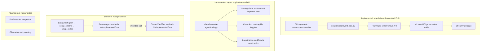

# Architecture

This document describes only behavior and structure present in the repository.
**Implemented** means code exists and can perform the stated responsibility;
it does not imply that the component is connected to the application workflow.
**Planned** identifies intended functionality that is not implemented.

## Overview

There are two separate Python entry points:

- **Implemented — standalone PoC:** `scripts/streamyard_poc.py` launches
  Microsoft Edge with an existing persistent profile and navigates to
  StreamYard. It waits for terminal input so a person can interact with the
  page. It does not create a broadcast.
- **Implemented — agent scaffold entry point:**
  `church-service-agent/main.py` loads configuration and sets up logging, then
  exits without running the workflow.
- **Implemented as a callable skeleton, not an operational workflow:**
  `church-service-agent/workflows/workflow.py` builds a sequential LangGraph
  graph. The graph's node methods are stubs that raise `NotImplementedError`,
  and `main.py` does not call `build_workflow()`.

## Components and responsibilities

| Component | Status | Responsibility |
| --- | --- | --- |
| `scripts/streamyard_poc.py` | Implemented | Parse `--user-data-dir` or `STREAMYARD_EDGE_USER_DATA_DIR`, validate the directory, launch Edge through Playwright, navigate to the fixed StreamYard URL, fall back to Google sign-in if unauthenticated and credentials are in the environment, wait for user input, and close the context. |
| `church-service-agent/main.py` | Implemented | Load settings, configure logging, log startup, and exit. Workflow execution is a TODO. |
| `church-service-agent/settings.py` | Implemented | Load environment variables and, when `python-dotenv` is installed, a package-local `.env` file into a frozen `Settings` dataclass. |
| `church-service-agent/logging_config.py` | Implemented | Configure standard-library console and rotating-file logging. |
| `church-service-agent/models/schemas.py` | Implemented | Define Pydantic models for sermon information, stream configuration, and a service event. |
| `church-service-agent/agents/state.py` | Implemented | Define the `AgentState` TypedDict used as the graph state shape. |
| `church-service-agent/agents/agent.py` | Stub | Declare planning, StreamYard setup, and slide setup nodes; each raises `NotImplementedError`. |
| `church-service-agent/tools/browser.py` | Implemented | Provide a context manager that launches and closes a persistent Microsoft Edge context using Playwright and configured settings. |
| `church-service-agent/tools/streamyard.py` | Stub | Declare dashboard, create-stream, and list-stream operations; each raises `NotImplementedError`. |
| `church-service-agent/workflows/workflow.py` | Skeleton | Build a `plan` → `setup_stream` → `setup_slides` → end graph. Conditional edges, retries, and human-in-the-loop checkpoints are TODOs. |
| `church-service-agent/tests/test_basics.py` | Implemented | Test a model default and environment-backed settings. |
| ProPresenter integration | Planned | No ProPresenter client or automation is implemented. |
| Ollama planning/model integration | Planned | Settings exist, but no model client or planning integration is implemented. |

## Entry points and execution flow

### Standalone PoC

1. `scripts/streamyard_poc.py` parses its optional path argument.
2. It selects `--user-data-dir` or `STREAMYARD_EDGE_USER_DATA_DIR`; if neither
   is set or the directory does not exist, it logs an error and returns status
   `2`.
3. It launches a Playwright persistent context with `channel="msedge"` and
   `headless=False`, using the supplied existing profile.
4. It opens `https://streamyard.com/`, checks an available HTTP response status,
   and logs the page URL and title.
5. It waits for Enter, Ctrl+C, or input closure, then closes the Edge context.

The selected Edge profile must already be authenticated to StreamYard for the
existing session to be reused.

### Agent application

1. `church-service-agent/main.py` calls `load_settings()`.
2. It calls `configure_logging(settings)` and logs startup.
3. It logs that no workflow is wired up and exits.

`build_workflow()` can be called separately to compile a graph, but invoking
its nodes cannot complete: the corresponding `ServiceAgent` methods are
unimplemented. The graph is not invoked by the application entry point.

## Data flow

- **PoC:** a command-line argument or environment variable supplies an Edge
  user-data directory. Playwright opens that profile, and a page navigates to a
  hard-coded StreamYard URL. No service-event data is read or written.
- **Agent scaffold:** environment variables and an optional
  `church-service-agent/.env` populate `Settings`. `main.py` passes settings to
  logging setup. Pydantic domain models and `AgentState` define shapes, but no
  code currently loads a service event from `configs/` or passes one through
  the workflow.

## External systems and dependencies

- The standalone PoC uses the root `requirements.txt` and the synchronous
  Playwright API. It requires Microsoft Edge installed locally and uses an
  existing Edge profile.
- The agent scaffold uses `church-service-agent/requirements.txt`, including
  Pydantic, python-dotenv, Playwright, LangGraph, and pytest.
- StreamYard is reached through browser navigation in the PoC. No StreamYard
  API client is present.
- ProPresenter and Ollama are named in settings or stubs, but are not currently
  connected to external systems.

## Configuration

The standalone PoC accepts `--user-data-dir` or
`STREAMYARD_EDGE_USER_DATA_DIR`. Its StreamYard URL and visible-browser mode are
currently fixed in the script.

The agent application reads environment variables and optionally a `.env` file
from its own directory. Defaults and supported settings are defined in
`church-service-agent/settings.py`; `.env.example` lists example values for
those settings. The agent browser profile path is separately configured by
`BROWSER_USER_DATA_DIR`.

## Error handling and logging

The PoC logs validation and launch/navigation failures, returns nonzero status
codes for failures, and closes its browser context in a `finally` block.
Logging is configured for console output in its script entry point.

The agent application configures standard-library logging to the console and a
rotating file under its configured log directory. The current stub operations
do not implement operational error handling; they raise
`NotImplementedError`.

## Testing approach

`church-service-agent/tests/test_basics.py` currently checks a Pydantic model
default and that environment variables affect settings. There are no tests for
the PoC, browser lifecycle, StreamYard operations, logging, workflow execution,
or the main entry point.

## Architecture diagram

